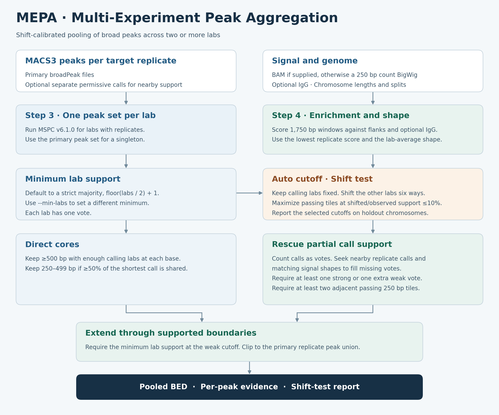

# MEPA (Multi-Experiment Peak Aggregation)

*Shift-calibrated pooling of broad peaks across labs.*

MEPA is provided as is. You're welcome to modify the code and open issues for bugs, questions, or suggestions. Replies are best effort, with no guaranteed turnaround. [Open an issue](https://github.com/KunFang93/mepa-peaks/issues/new)

Build a pooled broad-peak BED from two or more labs profiling the same mark in comparable samples. Step 3 builds within-lab consensus with MSPC v6.1.0. Step 4 combines lab-level peak calls, rescues loci with reproducible signal, and selects rescue thresholds using a within-chromosome shift test. A lab with one replicate contributes its full primary MACS3 peak set.



## Install

Use Python 3.11 or newer. Install this repository in a virtual environment. Download the MSPC v6.1.0 executable for your platform and put it on your path or pass its location with `--mspc`. [MSPC v6.1.0 release](https://github.com/Genometric/MSPC/releases/tag/v6.1.0)

```bash
python -m venv .venv
source .venv/bin/activate
python -m pip install .
mepa-peaks --help
```

## Inputs

All coordinates must use the same genome assembly and chromosome names. Supply a tab-delimited sample sheet with one row per treatment replicate or IgG control. Each lab needs at least one treatment replicate. The order in which labs first appear determines their assigned shift offsets. File paths are absolute or relative to the sample sheet. [Example with two paired labs and one singleton](examples/samples.tsv)

| Column | Treatment row (`target`) | Control row (`igg`) |
| --- | --- | --- |
| `lab`, `sample`, `role` | Lab ID, unique sample ID, and `target` | Matched lab ID, unique sample ID, and `igg` |
| `broadpeak` | Primary nine-column MACS3 broadPeak, plain text or gzip. MSPC reads column 8. | Leave blank |
| `permissive_broadpeak` | Optional second MACS3 call set used for the ±500 bp check. A blank field uses the primary set. | Leave blank |
| `bam` | Paired-end BAM for fragment counting | Matched paired-end IgG BAM |
| `bigwig` | Alternative 250 bp raw fragment-midpoint count BigWig | Alternative count BigWig for an IgG control |

Step 3 needs the primary peaks. Step 4 needs one signal source per sample. If both sources are supplied, **BAM takes precedence**. Use an empty `bam` field to select BigWig. BAM is read sequentially, so a BAM index is optional. Multiple IgG rows for a lab are pooled by summing midpoint counts and fragment depths. A lab without an IgG row uses its treatment flanks for background.

A count BigWig stores the **integer number of fragment midpoints per 250 bp tile**, anchored at chromosome position 0. The terminal tile can be shorter and omitted tiles count as zero. The library depth is the sum over the selected chromosomes. Use the following command to generate a compatible track, keeping MAPQ 0. Ordinary CPM coverage tracks contain a different quantity and need the original BAM for this conversion.

```bash
mepa-peaks export-midpoints \
  --genome genome.tsv --bam data/A_rep1.bam --output data/A_rep1.midpoints.bw
```

The genome TSV has columns `chrom`, `length`, and `split`. Order rows as desired for the BED. Only the listed chromosomes contribute to counts, normalization, and output. At least one chromosome needs the `calibration` label for Step 4.

| `split` | Role |
| --- | --- |
| `calibration` | Select the rescue thresholds |
| `holdout` | Report a separate shift-test result with the selected thresholds |
| `output_only` | Call peaks using the selected thresholds |

The included mm39 example uses odd autosomes for calibration, even autosomes other than chr2 for holdout, and chr2, X, and Y for output only. Calibration excludes a margin equal to the largest absolute shift at each chromosome end. For shorter chromosomes, you can specify six distinct shift sets with repeated `--shift-kb KB [KB ...]` arguments. Give one distinct nonzero offset per other lab in each set. Use displacements large enough to break the local alignment of peak signals. [mm39 chromosome table](examples/mm39.genome.tsv)

## Run

Run an input check, then stop after Step 3 to inspect the per-lab BEDs. Use a new output directory for each stage.

```bash
mepa-peaks check --samples samples.tsv --genome genome.tsv --mspc /path/to/mspc

mepa-peaks step3 \
  --samples samples.tsv --genome genome.tsv --mspc /path/to/mspc \
  --outdir results/step3_mspc

mepa-peaks step4 \
  --samples samples.tsv --genome genome.tsv --step3-dir results/step3_mspc \
  --outdir results/step4_pool --workers 4 --target-shift-ratio 0.10
```

To run both stages in one invocation, give `run` a parent directory. The stage outputs go into `step3_mspc/` and `step4_pool/` within it.

```bash
mepa-peaks run \
  --samples samples.tsv --genome genome.tsv --mspc /path/to/mspc \
  --outdir results --workers 4
```

### Minimum lab support

The default minimum is a strict majority, `n_labs // 2 + 1`. Two or three labs require support from two, four or five labs require three, and six labs require four. Set `--min-labs` on `step4` or `run` to choose an integer from 2 through the number of labs. For example, with four labs, `--min-labs 4` requires support from all four. Each lab contributes at most one vote.

## Method

### Step 3 · Within-lab consensus

For a replicated lab, convert each primary broadPeak to BED5 with `−log10(p)` from column 8 as the score. Cap the score at 300 to avoid underflow during MSPC's p-value conversion. Run MSPC in biological-replicate mode with overlap required in all replicates (`-c 2` for two replicates). The weak p-value cutoff is 0.01, the stringent cutoff and combined Fisher cutoff are both $10^{-5}$, and the Benjamini–Hochberg alpha is 0.05. When there are several overlapping peaks in a partner replicate, use the lowest p-value.

```bash
mspc -i rep1.bed rep2.bed -r bio -c 2 -w 1e-2 -s 1e-5 -g 1e-5 \
  -a 0.05 -m lowest -d 4 --excludeHeader -o consensus_output
```

Export the MSPC consensus coordinates as the lab-level BED. A singleton bypasses MSPC and uses its primary MACS3 coordinates and peak IDs. [MSPC input and arguments](https://genometric.github.io/MSPC/docs/cli/args/)

### Step 4 · Direct support, signal rescue, and extension

**Direct cores.** Keep continuous spans of at least 500 bp where each base is covered by lab-level calls from at least the required number of labs. Also accept an exact shared overlap of 250–499 bp from the required number of labs when it covers at least half of the shortest participating call.

**Fragment counts and enrichment.** Count one fragment per primary proper read 1 with a mapped mate on the same chromosome and nonzero template length. Exclude duplicate, QC-failed, secondary, and supplementary read 1 records. Retain every MAPQ, including 0. Place each fragment at the leftmost mate position plus half the absolute template length, rounded down. Count midpoints in seven 250 bp tiles centered on each focal tile (1,750 bp).

For each replicate, estimate the expected count from the combined per-bin mean in the flanks (tiles 11–42 on each side), scaled to the size of the count window. For optional IgG, sum the matched IgG window counts, add one pooled pseudocount, and multiply by the ratio of treatment depth to pooled IgG depth. The expected count $\mu$ is the maximum of the flank expectation, the IgG expectation if supplied, and 0.5. Near chromosome ends use available bins. With zero available flank bins the flank estimate is zero. The signed Poisson deviance score for observed count $k$ is

$$
z = s\sqrt{2[k\ln(k/\mu) - (k-\mu)]}
$$

The sign $s$ is $+1$ when $k > \mu$, $-1$ when $k < \mu$, and $0$ when $k = \mu$. Use $k\ln(k/\mu)=0$ when $k=0$. The **lowest replicate score** is the lab score. For example, 12 observed fragments against 10 expected gives $z\approx 0.61$.

**Rescue partial call support.** The center of a candidate tile has at least one lab-level call and fewer calls than the configured minimum. The highest-scoring calling lab is the anchor and must meet the weak score cutoff. Ties follow sample-sheet lab order. Each calling lab supplies one vote.

A lab without a call can supply a signal vote if it has a permissive MACS3 peak within 500 bp of the center in **every replicate** and its signal shape matches the anchor. For shape, sum counts in a 750 bp window, convert to fragment CPM per replicate, average replicate profiles equally within each lab, and take the square root. Compute Pearson $r$ on 17 points (4,250 bp in tiles). Keep the best $r$ across shifts of −500, −250, 0, +250, and +500 bp.

Fill the missing votes with labs that reach the weak cutoff, with at least one of those labs reaching the strong cutoff. A second route accepts one extra signal vote at the weak cutoff. With two labs, a single lab-level call can be rescued by strong signal from the other lab. With four labs and the default minimum of three, two calls plus one strong signal vote qualify, as do two calls plus two weak signal votes. Require at least two adjacent passing tiles with the same anchor. Clip the rescued runs to the union of the primary replicate peaks and retain clipped spans of at least 500 bp.

**Extend boundaries.** At least the required number of labs must reach the weak enrichment cutoff in each tile, with evidence from a lab-level call or permissive calls near the center in every replicate. Grow through runs of at least two such tiles that overlap a core after clipping to the primary replicate peak union. A gap in support or in that union breaks extension.

### Auto cutoff · Shift test

Evaluate the grid on the calibration chromosomes.

| Parameter | Candidate values |
| --- | --- |
| Weak signed Poisson score | 0.50, 0.75, 1.00, 1.25 |
| Strong signed Poisson score | 2.00, 2.25, 2.50, 2.75, 3.00, 3.50 |
| Minimum Pearson $r$ | 0.55, 0.60, 0.65, 0.70, 0.75, 0.80 |

1. Count observed passing seed tiles after the continuity check and before clipping. Candidate centers have partial call support and lie outside the retained 500 bp direct cores.
2. Keep the anchor and other calling labs fixed at each candidate tile. Move each noncalling lab's score, permissive-call mask, shape profile, and lab-level call mask together within that chromosome. For each anchor, assign offsets to the other labs in sample-sheet order. The six default pairs for three labs are `(211, -389)`, `(-227, 457)`, `(517, 875)`, `(-571, -821)`, `(383, -679)`, and `(-419, 733)`, in kb. Two-lab runs use the first offset of each pair. Runs with more labs append distinct offsets for the additional labs. The exact offsets are recorded in `thresholds.json`. Compare the same interior positions in all seven tests and retain a shifted tile when every originally noncalling lab still lacks a lab-level call there.
3. For each shift, group candidate tiles by the number of calling labs. Within a group, multiply the shifted passing tile count by the observed eligible tile count divided by the shifted eligible tile count. Sum the adjusted counts across groups. Divide the mean of the six adjusted totals by the observed passing tile count. A shift needs eligible tiles in every represented group to define the ratio.
4. Among settings with a defined ratio at or below 0.10, choose the setting with the most observed passing tiles. Break ties by higher weak score, higher strong score, then higher correlation. Evaluate the selected setting independently on the holdout chromosomes when supplied.

For example, 26,190 observed seed tiles and a mean of 1,814.53 adjusted shifted tiles give a ratio of 0.0693. The reference run selected weak 0.5, strong 2.0, and $r\ge 0.55$. The ratio was 6.9% on calibration and 6.7% on holdout. Interpret the ratio as an accidental-support diagnostic for **signal-rescue tiles**. Estimating peak-level biological error requires independent truth data. If no grid setting qualifies, Step 4 reports `direct_only` and exports the direct overlap cores.

## Outputs

| File | Contents |
| --- | --- |
| Step 3 `peak_beds/*.bed` | One lab-level BED4 per lab |
| Step 3 `peak_summary.tsv` and `step3.json` | Lab counts, MSPC version, and input and output peak checksums |
| Step 3 `mspc/` and `mspc_inputs/` | Native MSPC files, commands, logs, and scored inputs |
| Step 4 `pooled_peaks.bed` | Final 0-based half-open pooled peaks |
| Step 4 `pooled_peak_evidence.tsv` | Per-peak bases from direct overlap, short overlap, signal rescue, and shoulder extension |
| Step 4 `thresholds.json` | Minimum lab support, selected cutoffs, shift configuration, and calibration and holdout metrics |
| Step 4 `signal_threshold_calibration.tsv` | All grid scores, grouped by split and anchor lab |
| Step 4 `count_summary.tsv`, `peak_inputs.tsv`, `pooling_summary.json` | Signal source and depth, peak inputs, and final peak counts and spans |

The `both_weak_seed_bp` evidence column records rescue under the extra weak-vote rule. Its name comes from the default three-lab case, where two weak signal votes can rescue a single call.

## Upstream MACS3 settings for the reference run

**Applicability.** MEPA was originally developed for broad H3K9me3 peaks in mouse embryonic stem (mES) cells. For transcription factors and other histone modifications with different peak widths or signal shapes, test assay-specific MACS3 settings on your own data. Use replicate agreement and matched controls, where available, to check that MEPA's overlap lengths and signal windows are appropriate before interpreting pooled peaks.

The Step 3 and Step 4 commands expect existing peak files. The reference study used MACS3 3.0.2 on properly paired, primary, nonduplicate nuclear alignments, including MAPQ 0. The primary call used `-f BAMPE -g mm --broad --keep-dup all --llocal 20000 --max-gap 500 -q 0.05 --broad-cutoff 0.10`. The separate permissive call used `-f BAMPE -g mm --broad --keep-dup all -p 0.001 --broad-cutoff 0.05` with the caller's default local window and gap. In each call, supply the matching IgG BAMs via `-c` where available. The shift test calibrates the **Step 4 score and shape cutoffs**. MACS3 and MSPC use their specified peak-calling settings. [MACS3 callpeak documentation](https://macs3-project.github.io/MACS/docs/callpeak.html)

## Validation

A replay of the reference three-lab mm39 analysis reproduced all 43,309 pooled peak coordinates, the per-peak evidence lengths, and all 1,152 calibration grid rows. Synthetic tests cover rescue with two, four, and six labs, the minimum-support override, and agreement between BAM and exported count BigWigs with MSPC and shift calibration.

```bash
MEPA_MSPC=/path/to/mspc python -m unittest discover -s tests -v
```
